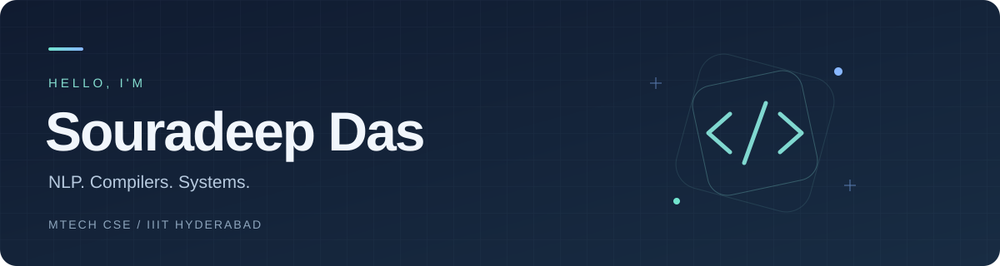

  

  <strong>MTech CSE · IIIT Hyderabad</strong> 
  Building across language models, computer vision, and systems.

  
  
  

## 👋 About me

- Pursuing an **MTech in Computer Science and Engineering at IIIT Hyderabad** (2025–present).
- BTech in CSE from **Government College of Engineering and Leather Technology** (2021–2025).
- My projects span **language models, corpus tooling, computer vision, compilers, and distributed systems**.
- Previously an **AI Agent Evaluator at Scale AI** (contract, May–June 2026), designing and evaluating SFT trajectories for tool-using LLM agents.
- I enjoy making the whole pipeline inspectable—from corpus-cleaning decisions to compiler intermediate representations.

---

## 🚀 Selected projects

| Project | What it does | Built with |
| :--- | :--- | :--- |
| **[BhashaLM](https://github.com/shadesin/BhashaLM)** | Bengali and Nepali language models from scratch: 1.28B training tokens, independent tokenizers, two 25.1M-parameter Transformers, and reproducible training and evaluation. | Python · PyTorch · SentencePiece |
| **[CorpusLens](https://github.com/shadesin/CorpusLens)** | A streaming CLI that audits text-cleaning policies, explains rejected records, and produces reproducible corpus reports. | Python |
| **[PoppyPure v2](https://github.com/shadesin/PoppyPurev2)** | A local computer-vision app that predicts semolina adulteration levels in poppy-seed photos. | Python · PyTorch · HTML/CSS/JS |
| **[Racket → x86-64 Compiler](https://github.com/shadesin/racket-compiler)** | A 14-pass compiler for a typed Racket subset, with register allocation, garbage collection, tail calls, and intermediate and native tests. | Racket · x86-64 Assembly |
| **[Peer-to-Peer File Sharing](https://github.com/shadesin/peer-to-peer-file-sharing-system)** | Tracker-based file sharing with dual-tracker failover, parallel downloads, and piece-level integrity checks. | C++ · TCP · OpenSSL · Linux |

<a href="https://github.com/shadesin?tab=repositories">Explore all repositories →</a>

---

## 🛠️ Skills & technologies

**Languages**

**Machine learning**

**Tools & databases**

---

## 🏆 Achievements

- **GATE 2025:** AIR **1197** · Score **706/1000** · **99.30 percentile**.
- **IIIT-H PGEE 2025:** AIR **47** among 5,000+ candidates.
- **WBJEE 2021:** GMR **3021**
- **Technophilia ’22, Jadavpur University:** **3rd place** among 150+ teams with team **3 Geeks**.
- **BTech CSE:** Graduated with a **9.01 GPA**.

---

## 📊 GitHub stats

  
  

---

## 🤝 Let's connect

  
  
  

